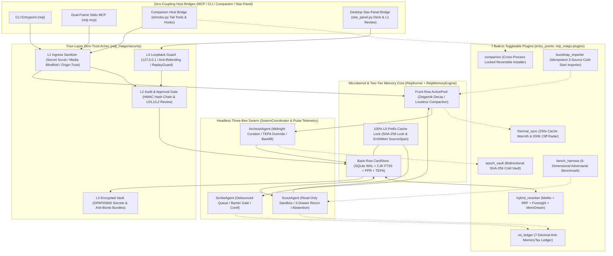

<p align="center">
  
</p>

<h1 align="center">Reiji-Maigo (零时迷子)</h1>

<p align="center">
  <strong>Zero-Dependency Two-Tier Working Memory &amp; Bitemporal State Microkernel in Pure Python 3.10+ Stdlib — Single-File SQLite WAL, 100% Locked L0 Prefix Cache, Headless Three-Bee Swarm, Four-Layer Zero-Trust Armor, and 7-Decimal Anti-MemoryTax Ledger.</strong>
</p>

<p align="center">
  <a href="https://github.com/zanex-dev/reiji-maigo/actions/workflows/ci.yml"></a>
  <a href="pyproject.toml"></a>
  <a href="LICENSE"></a>
  <a href="pyproject.toml"></a>
  
  
</p>

<p align="center">
  <a href="README.md"><strong>English</strong></a> · <a href="README_ZH.md"><strong>简体中文</strong></a> · <a href="AGENTS.md">Architecture &amp; Agent Map</a> · <a href="CHANGELOG.md">Changelog</a>
</p>

---

## 🔒 Zero-Trust Security Self-Verification (Audit in 3 Seconds)

Long-term memory is an AI agent's highest-value attack surface — a single prompt-injected tool output or accidentally stored API key can poison every future session. `reiji-maigo` enforces strict physical and cryptographic boundaries from line one:

1. **Zero Third-Party Dependencies (`dependencies = []`)**: The microkernel, SQLite WAL + CJK-Bigram `FTS5` ledger, `Personalized PageRank` graph engine, three-bee swarm, encrypted vault, and native `Stdio MCP` server run **100% on the Python `>= 3.10` standard library** (plus native Win32 `ctypes`) — zero external `pip` supply-chain risk.
2. **Zero Unprompted External Egress (`Stdio` / `127.0.0.1` Only)**:
   - `reiji mcp` operates strictly over local `stdin/stdout` pipes with zero open network ports;
   - `reiji serve` hard-enforces `127.0.0.1` (`SO_EXCLUSIVEADDRUSE` on Windows to prevent port hijacking), anti-DNS-rebinding `Host`/`Origin` validation, and bounded `ReplayGuard` request-ID protection;
   - Outbound LLM calls occur **only** when you explicitly configure a Flash endpoint via `reiji vault set-flash` or environment variables.
3. **Four-Layer Zero-Trust Memory Armor (`reiji_maigo/security/`)**:
   - **L1 Ingress Sanitizer (`sanitizer.py`)**: Zero-latency scrubbing of PEM keys, PATs, Bearer tokens, and API keys; physical blindfolding of personal media directories and binary image/audio/video paths; and `ORIGIN_TRUST_LEVELS` (`user_verified` / `assistant` / `untrusted_external`) blocking untrusted tool outputs from mutating authoritative memory;
   - **L2 Tamper-Evident Hash Chain & Approval Gate (`audit_gate.py`)**: Every sensitive action is appended to an `HMAC`-linked audit chain; high-risk overwrites/revocations on protected domains enter an `L0/L1/L2` human-approval queue;
   - **L3 Encrypted Credential Vault & Anti-Bomb Bundles (`vault.py`)**: Credentials rest inside Win32 `DPAPI` or POSIX `0600` encrypted storage; every `MemoryCard` carries a domain-separated `HMAC-SHA256` seal (`card_seals`), and portable archives enforce `ZIP_STORED` anti-zip-bomb verification.
4. **3-Second Source Audit Command**:

```powershell
# PowerShell — inspect every network, subprocess, socket, and bind-address call across the package:
Get-ChildItem .\reiji_maigo -Recurse -Filter *.py | Select-String -Pattern "HTTPConnection|urlopen|subprocess|socket|0\.0\.0\.0|shell=True"
```

```bash
# Linux / macOS
grep -rnE "HTTPConnection|urlopen|subprocess|socket|0\.0\.0\.0|shell=True" ./reiji_maigo
```

---

## ✨ Design Philosophy: Breaking the Two Traps of 2026 Agent Memory

Named after the *Midnight Lost Child* (**零时迷子**) — the treasure tool that fully restores its bearer's vessel every night at the stroke of midnight — `reiji-maigo` is engineered to escape the two failure modes plaguing modern agent memory:

- **Trap 1: Flat `MEMORY.md` Files & In-Place System-Prompt Edits (`MemGPT` style)** — Mutating the system block **shatters your `L0` Prompt KV Cache on every write**. Worse, once a codebase undergoes multiple architectural pivots, superseded drafts accumulate alongside final decisions in flat context, causing frontier model accuracy to collapse below no-memory baselines (`TEPA` / `MemDelta`).
- **Trap 2: Heavy Vector + Graph DBs + Online Per-Turn Rewriting** — Requiring Docker, vector stores, graph servers, and embedding APIs introduces severe **`MemoryTax`**: burning tens of thousands of extra tokens and multi-second TTFT overhead online just to save a few hundred tokens of context, resulting in negative net ROI.

**Reiji-Maigo takes a third path**: keep the online hot path **zero-blocking and 100% prefix-cache-locked**, while offloading distillation, chain compaction, and bitemporal conflict resolution to an **isolated three-bee Flash swarm and midnight curation**:

| Dimension | Flat `MEMORY.md` / System-Block Edits | Heavy Vector + Graph DB Stack | **Reiji-Maigo (零时迷子)** |
|---|---|---|---|
| **Runtime Dependencies** | None, but unstructured & unindexed | Docker + Vector DB + Graph DB + Embeddings | **`dependencies = []` (100% Python Stdlib)** |
| **Storage Engine** | Fragile plain text, unbounded growth | Multi-service cluster, painful backups | **Single-File SQLite WAL + CJK FTS5 + 15-Line PPR** |
| **L0 Prefix KV Cache** | ❌ Shattered on every header edit | ⚠️ Frequent dynamic top-of-prompt misses | **✅ `100%` Locked L0 Prefix (tail-mounted tools)** |
| **Pivots & Retractions** | ❌ Stale drafts linger & confuse attention | ❌ Cosine similarity blends old & new truths | **✅ `TEPA` Bitemporal Supersede & Revoke** |
| **Anti-Hallucination** | ❌ Lossy summaries, jokes treated as fact | ❌ Decontextualized chunks, ungrounded claims | **✅ Banter Gate + `EnSIMem` `SourceSpan` + Abstention** |
| **Cost Transparency** | Untracked | Hidden token bloat & negative `MemoryTax` | **✅ `7`-Decimal Anti-`MemoryTax` ROI Ledger** |
| **Poisoning & Integrity** | Plaintext, vulnerable to web/tool injection | Lacks origin-trust tiers & card signatures | **✅ 4-Layer Zero-Trust Armor + `HMAC` Card Seals** |

### 🧪 Candid Author's Note: Why Zero Dense Vectors Yet & Early-Stage Status

1. **Zero Dense Vectors by Choice (and Honesty)**:
   - Right now, `reiji-maigo` uses **zero dense vector embeddings** — no Chroma, no Qdrant, no FAISS, and no external embedding APIs. Retrieval runs purely on deterministic **CJK-Bigram `FTS5` + Controlled `L2` Tag Projection (`MeMo`) + 15-Line `Personalized PageRank` + `RRF`**.
   - Why? First, pure cosine similarity over dense vectors is notoriously hard to control and debug when superseded drafts and active decisions share nearly identical wording. Second — **to be completely upfront** — I haven't mastered the failure modes of dense-vector retrieval deeply enough yet to feel comfortable baking an opaque black box into the core kernel.
   - Instead of bolting on vector tech I don't fully control just for buzzwords, `ReijiKernel` keeps the core 100% deterministic and exposes a clean **`register_providers("reranker", ...)` plugin slot** — so optional dense/hybrid embedding rerankers can be mounted externally in the future without touching a single line of the microkernel.
2. **First Exploratory Prototype (`v0.2` — Not the Final Form)**:
   - Treat this release as **an early-stage experimental prototype (Generation 1)** built to test these architectural hypotheses under real daily workloads. Prompt heuristics, decay thresholds, and plugin boundaries will evolve significantly once real longitudinal telemetry comes in — **this is our starting line of exploration, not a finished monument.**

---

## 🧭 Full-Pipeline Architecture

1. **Front-Row Working Memory · `ActivePool` (`reiji_maigo/pool/`)**: Bounded prefrontal working memory featuring 4D Zeigarnik unfinished-task retention decay and lossless-span chain compaction (condensing old steps while preserving 100% of `SourceSpan` turn coordinates).
2. **Back-Row Bitemporal Archive · `CardStore` + `MemoRRF` (`reiji_maigo/cards/` & `plugins/hybrid_reranker.py`)**:
   - Enforces 5 locked L1 domains (`proj` / `infra` / `research` / `companion` / `life`) and an anti-entropy controlled L2 tag dictionary;
   - **Four-Level Page-Fault Recall Ladder**: `Level 0` zero-mount banter bypass ➔ `Level 1` `MeMo` controlled-tag projection + `PPR` multi-hop graph diffusion + `RRF` hybrid fusion ➔ `Level 2` verbatim `SourceSpan` turn slicing ➔ `Level 3` CJK-Bigram `FTS5` deep search with automatic `pending_backfills` sleep self-healing;
   - Built-in `Foresight` temporal expiry demotion (`[EXPIRED_FORESIGHT]`) and `MemDream` sleep self-probing that automatically backfills missed colloquial synonyms into tag aliases.
3. **Headless Three-Bee Swarm (`reiji_maigo/swarm/`)**: Each worker operates inside a physically isolated capability proxy (`Capabilities`) under a `SHA-256` byte-locked `L0` system prefix:
   - **🐝 `ScribeAgent`**: Debounced async worker filtering banter, resolving pronouns, updating `ActivePool`, and staging granular notes in `pool_event_notes` (physically barred from mutating `CardStore`);
   - **🐝 `ScoutAgent`**: Strictly read-only capability sandbox (`PermissionError` on any write) executing 3-drawer progressive reconnaissance with mandatory **honest abstention** when ungrounded;
   - **🐝 `ArchivistAgent`**: Midnight curator dropping transient `micro` noise, compacting long quest chains, minting 3-layer `MemoryCard` entries, resolving `TEPA` conflicts, and draining `Level 3` backfills.



---

## 🚀 60-Second Quick Start

### 1. Install & Inspect (Zero External Dependencies)

Requires **Python 3.10+** with zero third-party packages:

```bash
git clone https://github.com/zanex-dev/reiji-maigo.git
cd reiji-maigo
pip install -e . --no-deps
```

Check kernel health, loaded plugins, and the industrial swarm pulse banner (data defaults to `~/.reiji_maigo`, overridable via `REIJI_MAIGO_HOME`):

```bash
reiji status
reiji swarm status
```

Append a sanitized turn and run progressive + hybrid recall:

```bash
reiji turn --episode ep-demo --role user --content "Standardize on SQLite WAL mode with zero external vector databases."
reiji recall --query "SQLite WAL"
reiji rerank recall "external vector databases"
```

### 2. Native `reiji mcp` for AI IDEs & Agents (Antigravity · Claude Code · Cursor)

`reiji mcp` auto-negotiates both `NDJSON` and `Content-Length` framing over `stdio`, exposing 8 tail-mounted tools and 3 read-only resources without touching your frozen system prompt prefix.

Generate an exact interpreter-bound MCP snippet in one command:

```bash
reiji companion mcp-config --json
```

Or add `reiji-maigo` directly to your client's MCP configuration (append `"--read-only"` to physically hide mutating tools):

```json
{
  "mcpServers": {
    "reiji-maigo": {
      "command": "reiji",
      "args": ["mcp"],
      "env": {
        "REIJI_MAIGO_HOME": "~/.reiji_maigo"
      }
    }
  }
}
```

### 3. `reiji import` Idempotent Cold-Start Ingestion

Eliminate day-one empty-memory cold starts by importing existing stage handoffs, `transcript.jsonl` logs, or legacy SQLite stores (with automatic secret scrubbing, media blindfolding, and `SHA-256` fingerprint deduplication):

```bash
# Import Markdown handoff checkpoints (*.md) and mint HMAC-sealed seed MemoryCards
reiji import checkpoints ./workspace/.agents/checkpoints --domain proj

# Import JSONL transcripts or read-only legacy SQLite conversation databases
reiji import transcript ./session.jsonl
reiji import sqlite ./legacy_memory.db
```

### 4. `reiji bench run` Six-Dimensional Adversarial Scorecard

Validate `single_hop`, `multi_hop`, `temporal_foresight`, `tepa_reversal` (3-step `A -> B -> A'` cascading override), `abstention`, and `anti_poison_banter` in an isolated sandbox:

```bash
# Zero-cost deterministic regression (<0.1s isolated sandbox verification)
reiji bench run --markdown

# Live evaluation against your encrypted Flash endpoint
reiji vault set-flash --base-url https://api.example.com/v1 --api-key sk-xxx --model gemini-2.5-flash
reiji bench run --mode live --markdown
```

---

## 🛠️ CLI & Toggleable Plugin Matrix

### Core Microkernel Commands (9)

| Command | Purpose | Common Subcommands / Example |
|---|---|---|
| `reiji status` | Kernel status, schema version, storage counts & security summary | `reiji status --json` |
| `reiji pool` | Inspect hot `ActivePool` snapshot, events, or midnight triage plan | `reiji pool` / `reiji pool --triage` |
| `reiji recall` | Level 1–3 progressive recall (`PPR` / verbatim evidence / `FTS5`) | `reiji recall --query "SQLite WAL"` |
| `reiji turn` | Append a sanitized raw turn into the `FTS5`-indexed WAL ledger | `reiji turn --episode ep-1 --role user --content "..."` |
| `reiji swarm` | Orchestrate Scribe/Scout/Archivist & render pulse telemetry | `reiji swarm status` / `scribe` / `scout` / `midnight` |
| `reiji audit` | Verify tamper-evident hash chain, card HMAC seals & `L1` queue | `reiji audit verify` / `pending` / `approve` |
| `reiji vault` | Manage `DPAPI`/`0600` credential vault & anti-bomb bundles | `reiji vault set-flash ...` / `export-key` / `export` / `import` |
| `reiji serve` | Run `127.0.0.1` loopback HTTP server (`ReplayGuard` + anti-rebind) | `reiji serve --port 18721` |
| `reiji mcp` | Launch zero-dependency dual-frame Stdio MCP server | `reiji mcp` / `reiji mcp --read-only` |

### Built-In Self-Bootstrapping Plugins (7 · Individually Toggleable)

| Plugin | CLI Command | Subcommands | Capability |
|---|---|---|---|
| `roi_ledger` | `reiji roi` | `status` / `reconcile` / `record-saving` / `set-pricing` | 7-decimal USD anti-`MemoryTax` ledger & `1e-7` reconciliation |
| `epoch_vault` | `reiji epoch` | `scan` / `seal` / `verify` / `restore` | Bidirectional `SHA-256` append-only cold vault & tombstone restore |
| `thermal_sync` | `reiji radar` | `status` / `probe` / `sync` | Win32 lock-free 16KB tail reader & `250s` warmth / `200K` cliff sync |
| `companion` | `reiji companion` | `status` / `install` / `uninstall` / `mcp-config` | Cross-process locked, corrupt-backup-safe hook/skill installer |
| `hybrid_reranker` | `reiji rerank` | `recall` / `foresight` / `dream` | `MeMo` tag projection, `RRF` fusion, foresight sweep & `MemDream` |
| `bootstrap_importer` | `reiji import` | `status` / `transcript` / `sqlite` / `checkpoints` | `SHA-256`-deduplicated 3-source cold-start memory importer |
| `bench_harness` | `reiji bench` | `run` / `list-cases` | 6-dimensional adversarial memory benchmark & Markdown scorecard |

### Environment Variables & Bare-Kernel Switches

| Variable | Default | Description |
|---|---|---|
| `REIJI_MAIGO_HOME` | `~/.reiji_maigo` | Root directory for SQLite WAL database, audit chain & vault |
| `REIJI_MAIGO_DISABLE_PLUGINS` | `0` | Set `1` / `true` to run in **pure zero-plugin bare-kernel mode** |
| `REIJI_MAIGO_DISABLED_PLUGINS` | *(empty)* | Comma/semicolon-separated plugin opt-out list (e.g. `roi_ledger,thermal_sync`) |
| `REIJI_MAIGO_EPOCH_VAULT_DIR` | `<HOME>/epoch_vault` | Custom directory for the append-only cold epoch vault |
| `REIJI_COMPANION_CONFIG_DIR` | `~/.gemini/config` | Target config directory override for `reiji companion` |

---

## 📜 License & Commercial Authorization

Released under the **[PolyForm Noncommercial License 1.0.0](./LICENSE)** ([official text](https://polyformproject.org/licenses/noncommercial/1.0.0)):

- **Free for Noncommercial Use**: Personal study, individual developer workflows, academic research, educational institutions, public research organizations, and non-profit charities.
- **Commercial Use Requires Prior Written Authorization**: Any commercial deployment, enterprise internal production use, paid product integration, or commercial SaaS hosting requires prior written authorization from the author.

> Copyright (c) 2026 zanex — Commercial use requires prior written authorization from the author.
