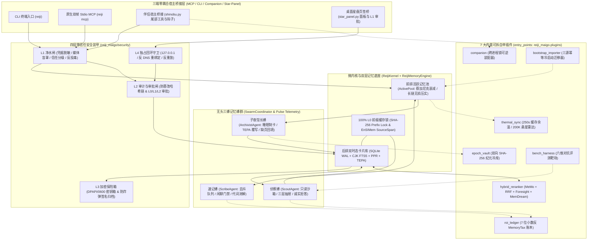

<p align="center">
  
</p>

<h1 align="center">Reiji-Maigo (零时迷子)</h1>

<p align="center">
  <strong>纯 Python 3.10+ 零依赖双层工作记忆与双时态状态机微内核 —— 单文件 SQLite WAL、100% 锁定 L0 前缀缓存、无头三蜂异步蒸馏、四层零信任安全装甲与 7 位小数反 MemoryTax 算力经济学账本。</strong>
</p>

<p align="center">
  <a href="https://github.com/zanex-dev/reiji-maigo/actions/workflows/ci.yml"></a>
  <a href="pyproject.toml"></a>
  <a href="LICENSE"></a>
  <a href="pyproject.toml"></a>
  
  
</p>

<p align="center">
  <a href="README.md"><strong>English</strong></a> · <a href="README_ZH.md"><strong>简体中文</strong></a> · <a href="AGENTS.md">架构与模块导览</a> · <a href="CHANGELOG_ZH.md">更新日志</a>
</p>

---

## 🔒 零信任安全自证（3 秒源码验毒）

记忆库是 AI Agent 最敏感的神经中枢——一旦被恶意外部网页注入“伪造长期指令”或意外录入了明文 API Key，就会造成永久性的跨会话毒化与泄密。`reiji-maigo` 从第一行代码起执行严苛的物理隔离与密码学自证：

1. **100% 零第三方依赖（`dependencies = []`）**：微内核、SQLite WAL + CJK 双字 `FTS5` 引擎、海马体 `PPR` 图扩散、三蜂编排、安全保险箱与原生 `Stdio MCP` 全部构建于 Python `>= 3.10` 标准库（及原生 Win32 `ctypes`），彻底杜绝第三方 `pip` 供应链投毒。
2. **默认零外联与独占回环守卫（`127.0.0.1` / `Stdio`）**：
   - `reiji mcp` 仅走本地标准输入输出流（`stdin/stdout`），零网络端口监听；
   - `reiji serve` 强制绑定 `127.0.0.1`（Windows 下启用 `SO_EXCLUSIVEADDRUSE` 防端口劫持），内置反 DNS 重绑定（校验 `Host`/`Origin`）与有界反重放守卫（`ReplayGuard`）；
   - 仅当用户主动在本地保险箱或环境变量配置外部 Flash 模型接口时，`HttpFlashRunner` 才会按锁定前缀发起受控单轮推理。
3. **四层零信任记忆装甲（`reiji_maigo/security/`）**：
   - **L1 入库净水闸（`sanitizer.py`）**：零延迟擦除私钥/PAT/Bearer/API Key，物理盲罩个人媒体目录与位图/音视频路径，并按 `ORIGIN_TRUST_LEVELS`（`user_verified` / `assistant` / `untrusted_external`）硬性拦截外部不可信工具输出篡改权威记忆（防权限洗白与反记忆投毒）；
   - **L2 防篡改哈希链与高危审批闸（`audit_gate.py`）**：所有敏感操作写入 `HMAC` 链式审计账本；涉及受保护域的覆写/撤销自动进入 `L0/L1/L2` 分级审批队列，未获人工批准绝不落盘；
   - **L3 系统级加密保险箱与防炸弹归档（`vault.py`）**：本机凭据采用 Win32 `DPAPI` / POSIX `0600` 加密存储，每张记忆卡独立加盖域分离 `HMAC-SHA256` 封签（`card_seals`），导出/导入便携包强制采用 `ZIP_STORED` 防解压炸弹与整包签名核验。
4. **3 秒源码自审命令**：

```powershell
# PowerShell — 一键核查全仓网络、子进程与安全边界调用：
Get-ChildItem .\reiji_maigo -Recurse -Filter *.py | Select-String -Pattern "HTTPConnection|urlopen|subprocess|socket|0\.0\.0\.0|shell=True"
```

```bash
# Linux / macOS
grep -rnE "HTTPConnection|urlopen|subprocess|socket|0\.0\.0\.0|shell=True" ./reiji_maigo
```

---

## ✨ 为什么叫「零时迷子」？—— 破局 2026 Agent 记忆的两大死穴

在《灼眼的夏娜》中，宝具**「零时迷子」**会在每天午夜零点准时将宿主的消耗与创伤完全复原。而当下的 AI Agent 长期记忆恰恰困在两个死胡同里：

- **死穴一：手写扁平 `MEMORY.md` 或在线改写 System Prompt（`MemGPT` 模式）** —— 每次修改系统块都会**当场击碎 `L0` Prompt KV 缓存**；更致命的是，当项目经历过三次推翻重构后，新旧废案混杂在平面上下文里，注意力机制根本分不清第 3 天的废稿与第 25 天的定稿（`TEPA` 实证准确率甚至跌破无记忆基线）。
- **死穴二：重型向量库 + 图数据库 + 在线每轮 LLM 提炼** —— 不仅要背负 Docker、向量库、Embedding API 的沉重运维，还会掉进严重的 **`MemoryTax`（记忆税陷阱）**：为了省下几百 Token 的遗忘成本，在线读写反而多烧掉数万 Token 与数秒首字延迟（TTFT），算力净收益沦为负数。

**Reiji-Maigo（零时迷子）** 给出了第三种解法：**在线热路径零阻塞、零破缓存，把昂贵的语义反刍、长链压实与冲突消解全部交给异步无头三蜂与“午夜零点”睡眠期**：

| 评估维度 | 手写 `MEMORY.md` / 改系统块 | 重型向量库 + 图数据库堆栈 | **Reiji-Maigo（零时迷子）** |
|---|---|---|---|
| **运行时依赖** | 无，但无结构化检索与生命周期 | Docker + Vector DB + Graph DB + Embedding | **`dependencies = []`（100% Python 标准库）** |
| **存储引擎** | 纯文本易并发写坏、越滚越臃肿 | 多服务异构存储，备份迁移极重 | **单文件 SQLite WAL + CJK 双字 FTS5 + 15 行 PPR** |
| **L0 前缀 KV 缓存** | ❌ 每次改写头部直接整段碎缓存 | ⚠️ 动态头部注入频繁破坏前缀命中 | **✅ `100%` 锁定 L0 前缀（尾部工具按需渐进调取）** |
| **方案推翻与纠错** | ❌ 历史废案残留，反复误导注意力 | ❌ 向量余弦相似度混杂新旧冲突事实 | **✅ `TEPA` 双时态覆写与撤销（旧卡自动移出活跃池）** |
| **防幻觉与玩梗当真** | ❌ 仅剩失真摘要，玩笑吐槽易污染 | ❌ 脱离上下文切片，张冠李戴无从查证 | **✅ 闲聊门禁 + `EnSIMem` 原文坐标溯源 + 诚实拒答** |
| **算力成本账本** | 黑盒无统计 | 隐性 Token 膨胀与负向 `MemoryTax` | **✅ `7` 位小数反 `MemoryTax` 账本（精确核算净 ROI）** |
| **防投毒与权限边界** | 明文裸奔，极易被网页/工具注入 | 缺乏来源信任分级与密码学卡片封签 | **✅ 四层零信任装甲 + 卡片 `HMAC` 封签 + `L1` 审批** |

### 🧪 作者坦诚说明：为什么不用纯稠密向量，以及「初代摸索版」定位

1. **现阶段零向量依赖（可控性优先 + 不懂绝不硬塞黑盒）**：
   - 目前 `reiji-maigo` **完全没有使用任何稠密向量检索（Dense Vectors / Embeddings）**——不接 Chroma/Qdrant/FAISS，也不调外部 Embedding 模型，全靠确定性的 **CJK 双字 `FTS5` + 受控 `L2` 标签词表投影（`MeMo`）+ 15 行标准库 `PPR` 图扩散 + `RRF` 混合重排**。
   - 原因很直接：一是纯稠密向量的余弦相似度在工程实战里**没那么可控**（改过三次的废案和最终定稿语义极近，很容易一起捞出来污染上下文，出了错也极难归因调优）；二是实话实说，**我自己目前对稠密向量检索的深水区也还没彻底摸透**——没吃透的东西绝不为了蹭概念硬塞进核心底座当黑盒。
   - 正因如此，我们在 `ReijiKernel` 里专门预留了干净的 **`register_providers("reranker", ...)` 插件插槽**：底座永远保持 100% 透明可控，未来等真正有把握或有极限语义需求时，随时可以用独立外挂插件把向量重排无损叠加上去。
2. **第一版摸索阶段声明（起点而非终局形态）**：
   - 当前版本只是把这套「双层记忆池 + 双时态撤销 + 无头三蜂 + 反记忆税」设想跑通的**第一代试验性原型（Exploratory v0.2）**，尚处于边用边收集真实实验数据的摸索阶段，**绝不代表最终定型产物**；后续蒸馏策略、衰减参数乃至局部结构都会根据实战反馈持续大刀阔斧迭代。

---

## 🧭 全链路架构拓扑

1. **前排热工作台 · `ActivePool`（`reiji_maigo/pool/`）**：模拟人类前额叶工作记忆（硬限事件数与 Token 水位），内置四维蔡加尼克（Zeigarnik）未竟留存衰减与长链无损压实（缩短步骤文本但 100% 保留全部 `SourceSpan` 原文坐标）。
2. **后排双时态档案库 · `CardStore` + `MemoRRF`（`reiji_maigo/cards/` & `plugins/hybrid_reranker.py`）**：
   - 严锁五大一级域（`proj` / `infra` / `research` / `companion` / `life`）与防词表熵增的受控二级标签词典；
   - 通过 **四级缺页中断阶梯** 按需召回：`Level 0` 闲聊零挂载 ➔ `Level 1` `MeMo` 词表投影 + `PPR` 多跳图扩散 + `RRF` 混合重排 ➔ `Level 2` 按卡片绑定 `SourceSpan` 直切原文轮次 ➔ `Level 3` CJK 双字 `FTS5` 打靶切片并登记 `pending_backfills` 睡眠自愈；
   - 支持 `Foresight` 时效预期过期降权（`[EXPIRED_FORESIGHT]`）与 `MemDream` 睡眠自探针自动补全口语同义词别名。
3. **无头三蜂异步记忆蜂群（`reiji_maigo/swarm/`）**：三大角色均运行在物理隔离的能力沙箱（`Capabilities`）与 `SHA-256` 字节级锁定的 `L0` 系统前缀之下：
   - **🐝 速记蜂（`ScribeAgent`）**：非阻塞去抖队列，过滤寒暄玩梗、消解代词、向热池追加进展并将技术细节暂存至 `pool_event_notes`（绝不越权写长期卡）；
   - **🐝 侦察蜂（`ScoutAgent`）**：严格只读沙箱（任何写调用立即抛 `PermissionError`），跨三层抽屉深潜检索并浓缩高信噪比证据简报，无实据时强制触发**诚实拒答**；
   - **🐝 子夜馆长蜂（`ArchivistAgent`）**：零点睡眠期自动丢弃碎屑 `micro` 任务、压实长链、吸收二层笔记铸造双时态记忆卡、执行 `TEPA` 冲突覆写/撤销并消化 `Level 3` 缺页回填队列。



---

## 🚀 60 秒快速上手

### 1. 零依赖安装与自检

仅需 **Python 3.10+**，无需安装任何第三方包：

```bash
git clone https://github.com/zanex-dev/reiji-maigo.git
cd reiji-maigo
pip install -e . --no-deps
```

查看微内核健康状态、已挂载自举插件与脉搏遥测面板（默认数据目录 `~/.reiji_maigo`，可通过 `REIJI_MAIGO_HOME` 覆盖）：

```bash
reiji status
reiji swarm status
```

写入一轮对话并体验双时态三级召回与混合重排：

```bash
reiji turn --episode ep-demo --role user --content "本项目统一使用 SQLite WAL 模式，禁止引入外部向量库"
reiji recall --query "SQLite WAL"
reiji rerank recall "外部向量库"
```

### 2. 原生 `reiji mcp` 接入主流 IDE / Agent（Antigravity · Claude Code · Cursor）

`reiji mcp` 原生自适应 `NDJSON` 与 `Content-Length` 双帧协议，提供 8 个尾部工具与 3 个只读状态资源，绝不污染系统提示词前缀缓存。

一键生成绑定当前 Python 解释器的标准配置 JSON：

```bash
reiji companion mcp-config --json
```

或将以下片段加入客户端的 MCP 配置文件（支持追加 `--read-only` 物理隐藏写入工具）：

```json
{
  "mcpServers": {
    "reiji-maigo": {
      "command": "reiji",
      "args": ["mcp"],
      "env": {
        "REIJI_MAIGO_HOME": "~/.reiji_maigo"
      }
    }
  }
}
```

### 3. `reiji import` 存量记忆冷启动（幂等防重 · 自动净水）

告别新装空库期——直接把现有阶段交接单、历史会话 `transcript.jsonl` 或旧版 SQLite 记忆库喂入零时迷子（全程 `SHA-256` 指纹防重，重跑百次零重复入库）：

```bash
# 导入阶段交接单目录 (*.md) 并自动铸造带 HMAC 封签的初始种子卡
reiji import checkpoints ./workspace/.agents/checkpoints --domain proj

# 导入对话转录 JSONL 或只读旧版 SQLite 记忆库
reiji import transcript ./session.jsonl
reiji import sqlite ./legacy_memory.db
```

### 4. `reiji bench run` 六维对抗靶场跑分

对齐 `LongMemEval` / `MemoryAgentBench` / `TEPA` 六大试金石（单跳提取、跨窗多跳拼图、时效过期推理、三连环方案反转、无证据诚实拒答、玩梗与外部投毒免疫），一键输出可复现成绩单与 7 位小数净 ROI 报表：

```bash
# 离线零成本确定性回归（<0.1s 沙箱隔离验证全链路）
reiji bench run --markdown

# 挂载加密保险箱内的真实 Flash API 跑实弹评测
reiji vault set-flash --base-url https://api.example.com/v1 --api-key sk-xxx --model gemini-2.5-flash
reiji bench run --mode live --markdown
```

---

## 🛠️ 全量命令与插件矩阵

### 核心微内核命令（9 项）

| 命令 | 说明 | 常用子命令 / 示例 |
|---|---|---|
| `reiji status` | 查看微内核状态、Schema 版本、账本计数与安全摘要 | `reiji status --json` |
| `reiji pool` | 查看前排活跃记忆池快照、事件列表及子夜分诊计划 | `reiji pool` / `reiji pool --triage` |
| `reiji recall` | 执行三级渐进召回（PPR 图扩散 / 原文证据切片 / FTS5 深潜） | `reiji recall --query "SQLite WAL"` |
| `reiji turn` | 追加单轮对话入库并经 L1 净水闸自动脱敏与盲罩 | `reiji turn --episode ep-1 --role user --content "..."` |
| `reiji swarm` | 调度速记/侦察/馆长三蜂并渲染工业级「蜂群脉搏遥测面板」 | `reiji swarm status` / `scribe` / `scout` / `midnight` |
| `reiji audit` | 校验防篡改哈希链与卡片 HMAC 封签，审批 `L1` 高危变更 | `reiji audit verify` / `pending` / `approve` |
| `reiji vault` | 管理 DPAPI/0600 加密保险箱及签名防解压炸弹便携记忆包 | `reiji vault set-flash ...` / `export-key` / `export` / `import` |
| `reiji serve` | 启动独占 `127.0.0.1` 回环 HTTP 服务（反 DNS 重绑定与反重放） | `reiji serve --port 18721` |
| `reiji mcp` | 启动零依赖原生 Stdio MCP 服务器（双帧自适应 + 只读门禁） | `reiji mcp` / `reiji mcp --read-only` |

### 内置自举可选插件（7 项 · 支持逐个热拔插与纯净裸核模式）

| 插件名 | CLI 命令 | 核心子命令 | 能力说明 |
|---|---|---|---|
| `roi_ledger` | `reiji roi` | `status` / `reconcile` / `record-saving` / `set-pricing` | 7 位小数反 `MemoryTax` 算力经济学账本与双向误差对账 |
| `epoch_vault` | `reiji epoch` | `scan` / `seal` / `verify` / `restore` | 双向 `SHA-256` 校验、只增不删纪元冷库外迁与墓碑桩无损回灌 |
| `thermal_sync` | `reiji radar` | `status` / `probe` / `sync` | Win32 无锁共享尾读、250s 缓存余温状态机与 200K 翻倍悬崖同步 |
| `companion` | `reiji companion` | `status` / `install` / `uninstall` / `mcp-config` | 跨进程文件锁、坏 JSON 自动留底备份、可逆钩子/技能装配与 MCP 配置生成 |
| `hybrid_reranker` | `reiji rerank` | `recall` / `foresight` / `dream` | `MeMo` 受控词表投影、`RRF` 三路融合、时效过期巡检与 `MemDream` 自探针 |
| `bootstrap_importer` | `reiji import` | `status` / `transcript` / `sqlite` / `checkpoints` | `SHA-256` 指纹幂等去重的三源历史记忆冷启动迁移器 |
| `bench_harness` | `reiji bench` | `run` / `list-cases` | 六维记忆对抗评测靶场与 Markdown 成绩单渲染器 |

### 环境变量与裸核开关

| 环境变量 | 默认值 | 说明 |
|---|---|---|
| `REIJI_MAIGO_HOME` | `~/.reiji_maigo` | 本地 SQLite WAL 账本、审计链与加密保险箱根目录 |
| `REIJI_MAIGO_DISABLE_PLUGINS` | `0` | 设为 `1` / `true` 时一键退回 **0 插件纯净裸核模式** |
| `REIJI_MAIGO_DISABLED_PLUGINS` | 空 | 逗号/分号分隔按需禁用指定插件（如 `roi_ledger,thermal_sync`） |
| `REIJI_MAIGO_EPOCH_VAULT_DIR` | `<HOME>/epoch_vault` | 自定义只增不删纪元冷库落盘目录 |
| `REIJI_COMPANION_CONFIG_DIR` | `~/.gemini/config` | 自定义 `reiji companion` 钩子与技能装配目标目录 |

---

## 📜 许可证与商业授权声明

本项目采用 **[PolyForm Noncommercial License 1.0.0](./LICENSE)** 非商业开源许可证发布：

- **免费开放场景**：个人开发者日常使用、学术研究、非商业开源探索、教育机构与非营利组织均可免费阅读、修改与分发源码。
- **商业授权红线**：任何商业性使用（包括企业内部生产环境部署、集成至付费软件/SaaS 服务或商业售卖）均**严禁未经授权使用**，须事先联系作者获取书面商业许可。

> Copyright (c) 2026 zanex — Commercial use requires prior written authorization from the author.
